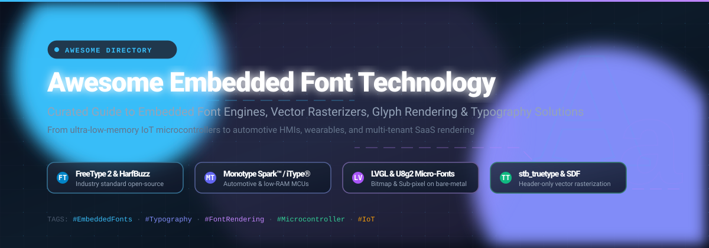

# Awesome-Embedded-Font-Technology 🔤⚡

  

  
  
  
  
  
  

---

## 📖 Overview & SEO Summary 🚀

Welcome to **Awesome Embedded Font Technology** — a curated, comprehensive index of **embedded font engines**, **vector glyph rasterizers**, **SaaS typographic APIs**, and **open-source font rendering libraries**. Designed for embedded systems developers, IoT firmware engineers, automotive HMI architects, smart wearable designers, and web platform builders seeking the highest rendering quality within strict memory (RAM/ROM) and CPU constraints.

Whether you are targeting low-power microcontrollers (such as ARM Cortex-M, ESP32, RISC-V, and STM32), bare-metal displays, automotive instrument clusters, or enterprise cloud-based document generation, this repository outlines both commercial SaaS solutions and high-performance open-source libraries.

---

## 📑 Table of Contents 📌
- [Sector Overview & Market Dynamics 📊](#sector-overview--market-dynamics-)
- [SaaS & Hosted Commercial Font Platforms ☁️](#saas--hosted-commercial-font-platforms-️)
- [Open-Source Font Engines & Embedded Graphics Libraries 💻](#open-source-font-engines--embedded-graphics-libraries-)
- [Architecture & Implementation Guide 🛠️](#architecture--implementation-guide-️)
- [Support & Community 💖](#support--community-)
- [Star History 📈](#star-history)
- [How to Contribute 🤝](#how-to-contribute-)
- [License 📄](#license-)

---

## Sector Overview & Market Dynamics 📊

The global digital typography, font licensing, and embedded font rendering engine market is estimated at **$1.2 billion to $1.8 billion**, with an anticipated compound annual growth rate (CAGR) of **6% to 8%**, propelled by surging adoption across automotive digital cockpits, smart consumer IoT devices, wearables, medical displays, and cloud document rendering pipelines.

The sector exhibits **high concentration with a winner-take-most dynamic in enterprise type IP and commercial OEM engines** (dominated by Monotype following key acquisitions and Adobe's Creative Cloud ecosystem), while maintaining a **vibrant, highly fragmented open-source ecosystem** (FreeType, HarfBuzz, LVGL, STB) that powers almost all independent firmware, bare-metal graphics pipelines, and community operating systems.

---

## SaaS & Hosted Commercial Font Platforms ☁️

The following table presents major commercial platforms and SaaS services offering embedded font engines, OEM distribution licenses, cloud font synchronization, or web/app typography APIs. Ranked in descending order by parent company scale (valuation / market capitalization / revenue).

| Company / Product | Platform / Product Scope | Company Valuation / Revenue Scale | Pricing Column (Specific Starting Tier) | Free Tier Limits Column (Specific Limit / Trial) |
| :--- | :--- | :--- | :--- | :--- |
| **[Adobe Fonts (Adobe Inc.)](https://fonts.adobe.com/)** 🎨 | Global cloud font delivery & Creative Cloud font synchronization library (thousands of curated foundry typefaces for UI/Web/Mockups). | **$100B–$115B+ Market Cap** (~$21B+ annual revenue) | **$9.99/month** (InCopy Single App CC plan) or **$59.99/month** (Creative Cloud All Apps) | **Free Forever plan** via Adobe ID with access to **1,000+ basic fonts**; standard plans offer a **7-day free trial** with full access to 20,000+ fonts |
| **[Google Fonts API (Alphabet Inc.)](https://fonts.google.com/)** 🌐 | Enterprise-scale CDN web font service, developer APIs, and open-source directory with global edge delivery. | **$2.0T+ Market Cap** (~$300B+ annual revenue) | **$0 / Free Forever** (Open-source infrastructure funded by Alphabet Inc.) | **Free Forever plan** with **unlimited pageviews & unlimited API queries** under SIL Open Font License / Apache 2.0 |
| **[Monotype Fonts (Monotype Imaging / HGGC)](https://www.monotype.com/)** 🔤 | Flagship OEM embedded font engines (*Monotype Spark™*, *iType®*) and enterprise font management SaaS for automotive, IoT, and app UI. | **~$825M Private Valuation** (~$300M–$400M estimated annual revenue) | **$199/year** for individual creative tier; OEM/Embedded engines start with custom quotes (typically **$3,000–$10,000+/year** by device run) | **30-day free trial** with access to explore the Monotype library and prototype embedded UI designs; no permanent free commercial tier |
| **[Type Network](https://www.typenetwork.com/)** 🏢 | Consortium of premier independent foundries offering specialized Software/App/SaaS embedding agreements and web typography. | **$10M–$25M Estimated Enterprise Scale** ($1M+/quarter partner royalty distributions; private) | **$15.00** one-time starting price per single font weight (desktop); app/embedded licenses starting at **$150/year** | **14-day free trial** on font testing for design validation and UI mockups upon foundry request |
| **[Fontself](https://www.fontself.com/)** 🖋️ | SaaS and desktop typography creation extension creating OpenType-SVG vector fonts directly in Illustrator, Photoshop, and iPad. | **$1M–$5M Bootstrapped Scale** (Self-funded, independent creative developer) | **$49.00** one-time perpetual license (single app) or **$59.00** for the Illustrator & Photoshop bundle | **Free for iPad basic viewing**; desktop add-on provides **no free trial**, backed by a 14-day money-back guarantee |
| **[Fontstand](https://fontstand.com/)** ⏱️ | Curated independent typography discovery and rental service with macOS/Windows desktop clients and font test environments. | **Independent / Bootstrapped** (<$5M private scale; founder-led consortium) | **$2.00/month** per font style (10% of standard perpetual retail price per month; 12 months rental converts to perpetual license) | **Free testing for 3 hours per font** for design layout and screen evaluation; no perpetual free commercial licensing |

---

## Open-Source Font Engines & Embedded Graphics Libraries 💻

Ranked in descending order by **GitHub Stargazers count** 🌟. Click on any Stars_Badge to jump directly to the repository's stargazers.

| Project Name | Repository | GitHub_Stars_Badge | Primary Language / Type | Description |
| :--- | :--- | :--- | :--- | :--- |
| **stb (`stb_truetype`)** ⚡ | [`nothings/stb`](https://github.com/nothings/stb) |  | C (Header-Only) | Legendary public domain header-only C library providing blazingly fast TrueType font parsing and rasterization, ideal for embedded games and resource-constrained UI. |
| **LVGL** 📱 | [`lvgl/lvgl`](https://github.com/lvgl/lvgl) |  | C | Most popular open-source embedded GUI library for microcontrollers and displays; includes built-in bitmap font engines, sub-pixel rendering, font converters, and FreeType bindings. |
| **Google Fonts** 📚 | [`google/fonts`](https://github.com/google/fonts) |  | Python / Fonts | Central collection of thousands of free and libre font families ready for web, desktop, and embedded device UI distribution under SIL OFL. |
| **U8g2** 📟 | [`olikraus/u8g2`](https://github.com/olikraus/u8g2) |  | C / C++ | Monochromatic graphics library for LCDs and OLEDs; features hundreds of ultra-compact pre-rendered bitmap fonts optimized for extreme memory constraints (down to 1KB RAM). |
| **HarfBuzz** 🔡 | [`harfbuzz/harfbuzz`](https://github.com/harfbuzz/harfbuzz) |  | C / C++ | Industry-standard text-shaping engine used globally in browsers, Android, and embedded devices to assemble complex unicode glyph sequences into proper layout coordinates. |
| **FontTools** 🔧 | [`fonttools/fonttools`](https://github.com/fonttools/fonttools) |  | Python | Essential library for manipulating fonts in Python, creating subsets (WOFF2/TTF), stripping unnecessary glyphs to save flash ROM on embedded firmware. |
| **msdfgen** 📐 | [`Chlumsky/msdfgen`](https://github.com/Chlumsky/msdfgen) |  | C++ | Multi-channel signed distance field font generator; generates compact texture atlases enabling infinitely crisp vector font rendering on GPU/OpenGL embedded screens. |
| **TFT_eSPI** 🖥️ | [`Bodmer/TFT_eSPI`](https://github.com/Bodmer/TFT_eSPI) |  | C++ | High-speed Arduino and ESP32 / ESP8266 TFT display library with custom smooth font rasterization engines, VLW fonts, and high-performance SPI drawing. |
| **resvg** 🖼️ | [`linebender/resvg`](https://github.com/linebender/resvg) |  | Rust | High-performance SVG and vector font rendering library designed as a standalone rendering library with strict specification compliance. |
| **Adafruit GFX** 🎛️ | [`adafruit/Adafruit-GFX-Library`](https://github.com/adafruit/Adafruit-GFX-Library) |  | C++ | Foundational core graphics library for Arduino, ESP32, and Raspberry Pi Pico; provides standard 5x7 and custom proportional bitmap fonts for micro displays. |
| **freetype-gl** ✨ | [`rougier/freetype-gl`](https://github.com/rougier/freetype-gl) |  | C / OpenGL | Hardware-accelerated OpenGL text rendering library utilizing FreeType 2 and texture atlas generation for embedded graphical systems. |
| **tiny-skia** 🎨 | [`linebender/tiny-skia`](https://github.com/linebender/tiny-skia) |  | Rust | Minimal, software-only 2D rendering pipeline in pure Rust without external dependencies; renders vector paths and font outlines directly to pixel buffers. |
| **libgd** 🖨️ | [`libgd/libgd`](https://github.com/libgd/libgd) |  | C | Dynamic image creation and text drawing library featuring embedded FreeType font loading and bitmap font rendering capabilities. |
| **FreeType 2** ⚙️ | [`freetype/freetype`](https://github.com/freetype/freetype) |  | C | The universally adopted font engine for TrueType, OpenType, and CFF rasterization; highly modular and portable across Linux, RTOS, and embedded devices. |
| **SDL_ttf** 🎮 | [`libsdl-org/SDL_ttf`](https://github.com/libsdl-org/SDL_ttf) |  | C | Companion library for SDL2/SDL3 providing high-level TrueType font rendering, wrapping FreeType into ready-to-blit SDL surfaces and textures. |
| **RustType** 🦀 | [`redox-os/rusttype`](https://github.com/redox-os/rusttype) |  | Rust | Pure Rust alternative for TrueType rasterization based on `stb_truetype`; lightweight, `#![no_std]` capable, and well suited for embedded Rust microcontrollers. |
| **mcufont** 💡 | [`mcufont/mcufont`](https://github.com/mcufont/mcufont) |  | C | Font rendering library and converter explicitly created for microcontrollers; features variable compression, kerning, and ultra-small runtime footprints. |

---

## Architecture & Implementation Guide 🛠️

When developing UI on resource-constrained embedded systems and IoT devices, selecting the appropriate font rendering architecture is crucial:

### 1. Pre-rendered Bitmap Fonts (Best for <32KB RAM) 🎯
* **Tools:** `u8g2`, `Adafruit-GFX`, `mcufont`, LVGL offline font converter.
* **Mechanism:** Glyphs are converted into static C byte arrays stored in flash ROM (`PROGMEM`).
* **Pros:** Zero runtime CPU decoding overhead; deterministic blitting speed.
* **Cons:** Cannot scale dynamically; distinct sizes require separate arrays.

### 2. Header-Only Vector Rasterizers (Best for 128KB–1MB RAM) ⚡
* **Tools:** `stb_truetype`, `RustType`, `tiny-skia`.
* **Mechanism:** Parses TTF outlines directly on the device and rasterizes glyphs on the fly into a software framebuffer.
* **Pros:** Single TTF can be scaled to any size; minimal code size (~10–30KB binary).
* **Cons:** Requires CPU power for bezier curves; requires an allocation buffer for glyph caching.

### 3. Signed Distance Fields / MSDF (Best for GPU/Hardware-Accelerated Displays) 🚀
* **Tools:** `msdfgen`, `freetype-gl`.
* **Mechanism:** Converts glyph contours into distance texture atlases. Modern shaders reconstruct razor-sharp edges at any magnification with minimal memory.
* **Pros:** Infinite crispness without storing multiple textures; very low texture bandwidth.
* **Cons:** Requires programmable fragment shaders (OpenGL ES / Vulkan / WebGL).

### 4. Enterprise Turnkey Commercial Engines 🏢
* **Tools:** Monotype Spark™, Monotype iType®.
* **Mechanism:** Patented auto-hinting, sub-pixel tuning, and specialized compression for international scripts (CJK, Arabic, Indic) inside ultra-low memory budgets.

---

## Support & Community 💖

Thank you so much for exploring **Awesome Embedded Font Technology**! If you find this curated resource helpful for your embedded systems, firmware projects, or typography pipelines:

- ⭐ **Star this repository** to help others discover it!
- 🍴 **Fork and contribute** your favorite font engines and tools.
- 📢 **Share with your team & networks** across embedded systems, IoT, and typography developer communities.
- ☕ **Support the maintainer**: If you'd like to fuel further updates and open-source curation, consider buying a coffee or sponsoring via the [GitHub Sponsor Dashboard](https://github.com/sponsors/ishandutta2007).

---

##  Star History

---

## How to Contribute 🤝

Contributions are very welcome! To maintain quality:
1. 🍴 Fork the repository.
2. 🌿 Create a feature branch: `git checkout -b feature/add-new-font-engine`.
3. 📝 Add your tool or library to the appropriate table.
4. 🌟 Ensure GitHub repositories include a Stars_Count badge linking to the stargazer page (`https://img.shields.io/github/stars/...`).
5. 📬 Submit a pull request detailing why the tool belongs in this embedded font directory.

---

## License 📄

This repository and its documentation are open-source and released under the [MIT License](LICENSE). 
All product names, trademarks, and registered logos belong to their respective owners.
